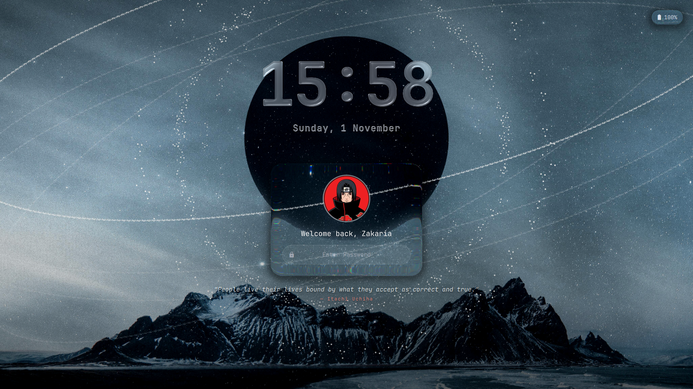
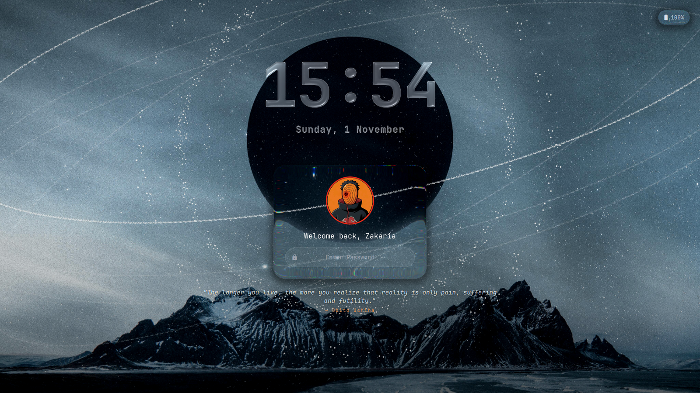
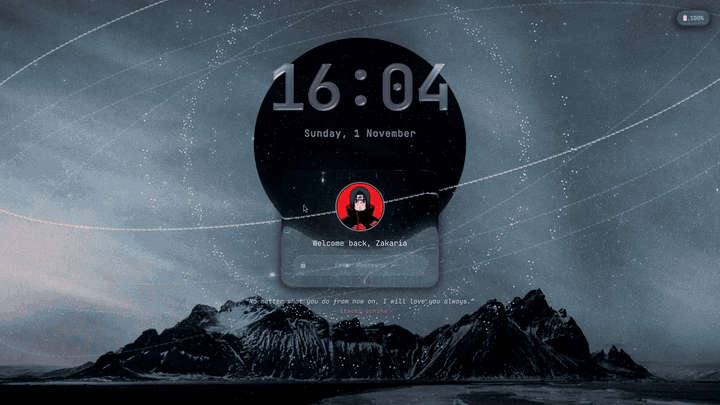

# Akatsuki Lock Screens: Itachi & Obito

Two Naruto-themed lock screens for [Omarchy](https://omarchy.org/), built as Quickshell shell plugins (cloned from the stock `omarchy.lock`).

| Itachi | Obito |
|---|---|
|  |  |

### In action

Each clip shows the idle screen, then clicking the avatar, then a wrong password.

**Itachi**: Tsukuyomi genjutsu, then Amaterasu



**Obito**: Kamui, then the Kamui warp on the card


Full-quality MP4s: [itachi.mp4](videos/itachi.mp4) · [obito.mp4](videos/obito.mp4)

Both have:

- **Liquid glass cards** (a port of [ybouane/liquidglass](https://github.com/ybouane/liquidglass)) that refract the wallpaper
- A glass clock and date
- A now-playing card (MPRIS) with art, progress bar and controls
- A battery chip
- Rotating character quotes under the login card

| Plugin | Character | Click the avatar | Wrong password |
|---|---|---|---|
| `zakaria.lock` | Itachi Uchiha | **Tsukuyomi genjutsu**: the world turns blood red, a giant Sharingan morphs into the Mangekyō, crows burst out | **Amaterasu**: black flames engulf the login card |
| `zakaria.obito` | Obito Uchiha | **Kamui**: space twists into a vortex around his eye, dark spiral arms sweep in, a giant Mangekyō spins | The card shakes and a Kamui warp opens behind it |

## Install

```bash
git clone https://github.com/ZakariaElkhadir/akatsuki-lockscreens
cp -r akatsuki-lockscreens/zakaria.obito akatsuki-lockscreens/zakaria.lock ~/.config/omarchy/plugins/

omarchy plugin enable zakaria.obito     # or zakaria.lock for Itachi
omarchy-restart-shell
```

Only one lock plugin can be active. Check which one is active with `omarchy plugin list | grep -E "lock|obito"`. To go back to the stock lock, run `omarchy plugin enable omarchy.lock`.

Preview without locking:

```bash
omarchy-shell lock preview
omarchy-shell lock hidePreview
```

## Customising

- **Quotes:** edit the `itachiQuotes` / `genjutsuQuotes` or `obitoQuotes` / `kamuiQuotes` arrays at the top of `LockView.qml`.
- **Avatar:** replace `assets/avatar.png` (512×512). The eye-glow position is hard-coded in `LockView.qml` in 512-px image coordinates.
- **Screen-off delay:** the display turns off after 60 s of no input on the lock screen (`idleBlankTimer` in `Service.qml`).
- **Shaders:** after editing a `.frag` file, recompile it:

  ```bash
  /usr/lib/qt6/bin/qsb --glsl "100es,120,150" --hlsl 50 --msl 12 -o shaders/X.frag.qsb shaders/X.frag
  ```

## About me

I'm [Zakaria Elkhadir](https://github.com/ZakariaElkhadir), and I designed and built both lock screens: the QML layouts, the GLSL shaders (Tsukuyomi, Amaterasu, Kamui and the liquid glass port) and the animations that tie them together.

I like shipping polished, finished things fast. This project went from idea to two complete, themed lock screens with custom shaders, media controls and recorded demos. If you like it, star the repo or reach out on GitHub. I'm always building something new.

## Credits

- [Omarchy](https://github.com/basecamp/omarchy): `Service.qml` (PAM and fingerprint auth) comes from the stock `omarchy.lock` plugin.
- [ybouane/liquidglass](https://github.com/ybouane/liquidglass): the liquid glass shader is a port of it.
- Naruto © Masashi Kishimoto. The avatar and Sharingan images are fan art and belong to their artists.
